

  

# 소비로그 · Sobilog

> 영수증 한 장으로 무엇을 샀는지까지 기록하는 가계부

소비로그는 영수증 사진이나 결제 화면을 올리면 가게 이름, 결제일, 품목, 수량, 금액을 읽어 가계부에 채워주는 앱입니다. 입력된 내용을 확인해 저장하고, 월별 소비와 지출 목표를 살펴보거나 함께 산 품목을 나눠 정산할 수 있습니다.

[App Store에서 다운로드](https://apps.apple.com/kr/app/%EC%86%8C%EB%B9%84%EB%A1%9C%EA%B7%B8-%EC%98%81%EC%88%98%EC%A6%9D-%EB%93%B1%EB%A1%9D-%EA%B0%80%EA%B3%84%EB%B6%80/id6815716175)

## 서비스 개요

| 핵심 기능 | 사용 방법 |
| --- | --- |
| 영수증 인식 | 영수증을 촬영하거나 결제 화면 캡처를 불러옵니다. 자동으로 채워진 품목과 추천 카테고리·결제수단을 확인하고 저장 전에 수정할 수 있습니다. |
| 가계부 | 수입과 지출을 직접 입력하고 일·주·월 단위로 조회합니다. 카테고리와 결제수단으로 원하는 내역을 골라 볼 수 있습니다. |
| 소비 분석과 목표 | 월별 카테고리 지출을 비교하고, 지출 목표를 설정해 남은 예산과 하루에 쓸 수 있는 금액을 확인합니다. |
| 품목별 더치페이 | 각 품목의 값을 나눠 낼 사람을 선택하면 참여자별 정산 금액이 계산됩니다. 계좌 정보와 금액이 담긴 정산 요청을 복사하거나 공유할 수 있습니다. |

## 앱 화면

| 영수증 촬영 | 인식 결과 확인 | 홈 · 월간 소비 요약 |
| :---: | :---: | :---: |
|  | 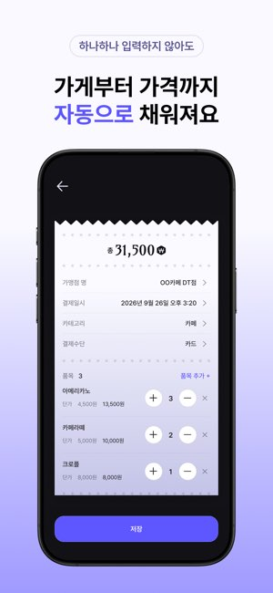 | 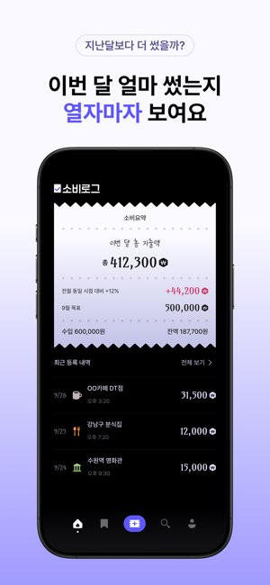 |

| 카테고리별 소비 분석 | 더치페이 · 품목별 인원 배정 | 더치페이 · 정산 요청 |
| :---: | :---: | :---: |
| 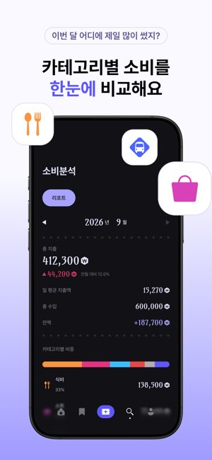 | 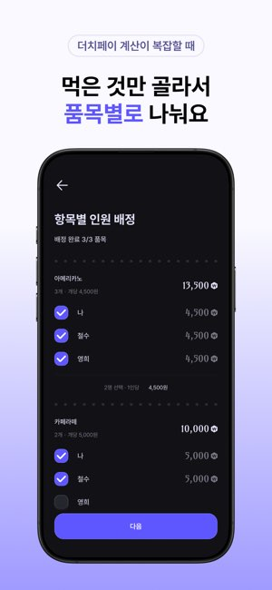 | 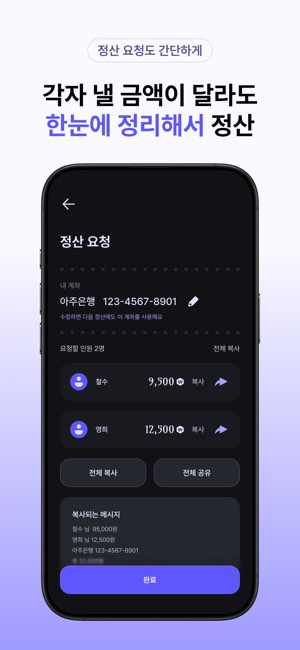 |

위 6장은 [App Store의 iPhone 미리보기](https://apps.apple.com/kr/app/%EC%86%8C%EB%B9%84%EB%A1%9C%EA%B7%B8-%EC%98%81%EC%88%98%EC%A6%9D-%EB%93%B1%EB%A1%9D-%EA%B0%80%EA%B3%84%EB%B6%80/id6815716175)입니다. 아래는 예시 데이터를 사용한 앱 QA 및 UI 테스트 캡처이며, 일부 화면은 개발 중인 버전에서 촬영했습니다.

### 수입·지출 등록

| 지출 직접 등록 | 수입 등록 | 카테고리 추가 |
| :---: | :---: | :---: |
| 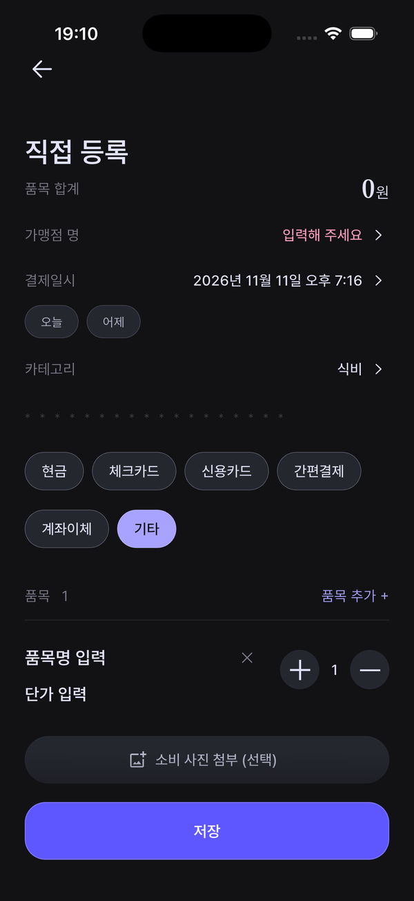 | 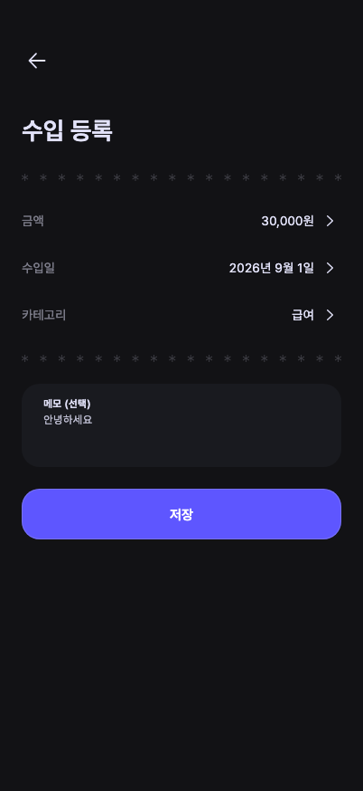 | 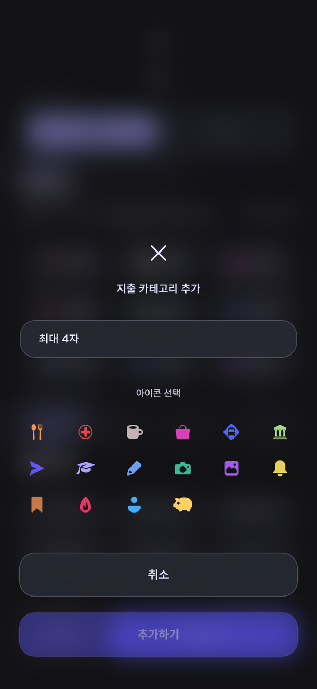 |

### 가계부 조회

| 월간 가계부 | 내역 필터 | 지출 상세 |
| :---: | :---: | :---: |
| 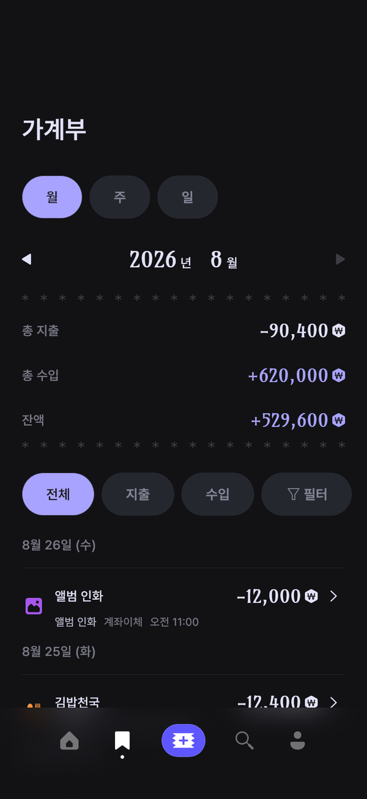 | 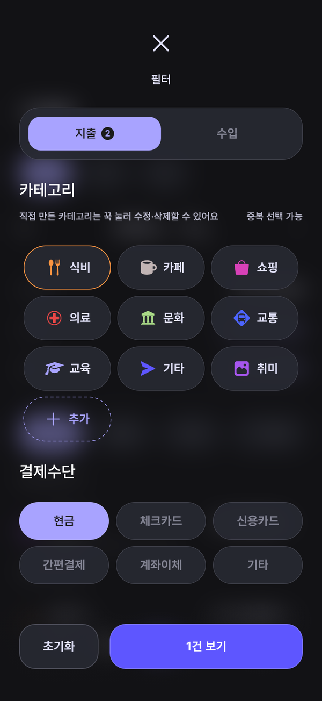 | 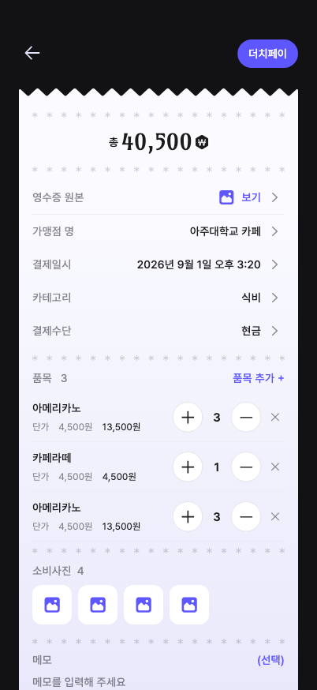 |

### 지출 목표와 소비 리포트

| 지출 목표 설정 | 소비 패턴 리포트 | 반복 지출 분석 |
| :---: | :---: | :---: |
| 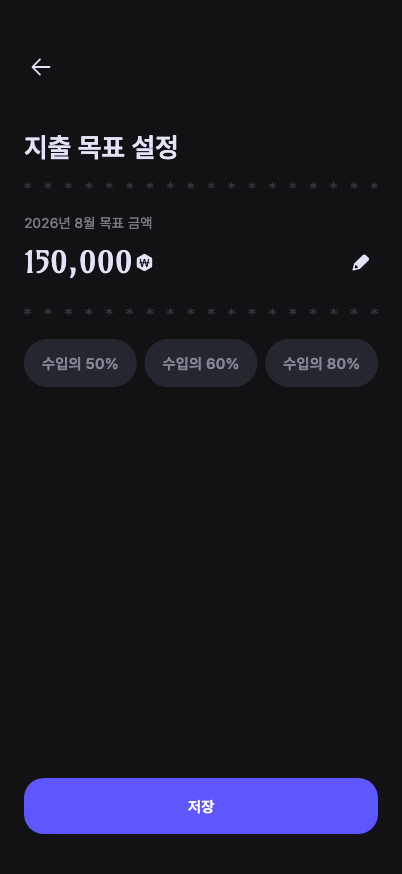 | 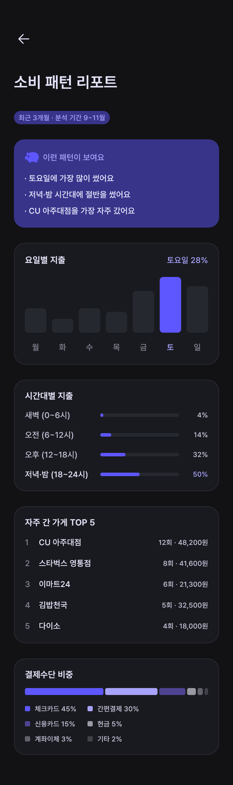 | 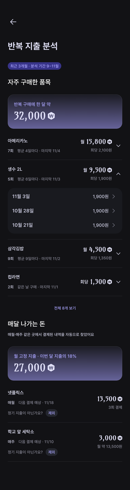 |

### AI 분석

| AI 분석 탭 | 소비 습관 진단 | 할인 찾기 |
| :---: | :---: | :---: |
| 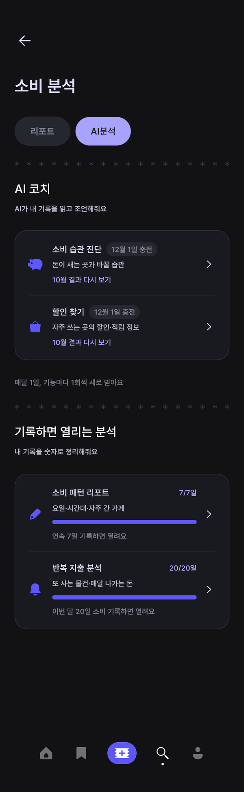 | 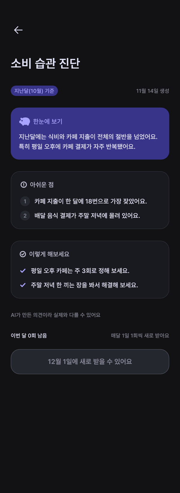 | 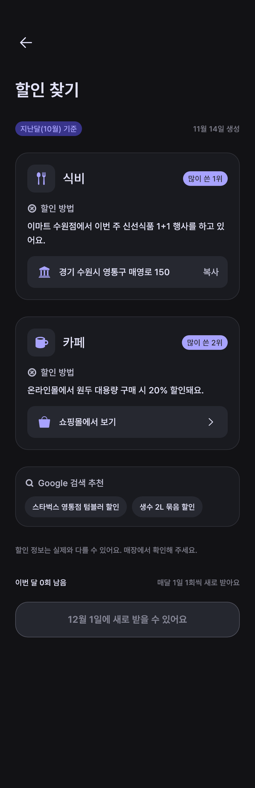 |

### 더치페이 설정과 정산 결과

| 참여자 등록 | 정산 결과 | 은행 선택 |
| :---: | :---: | :---: |
| 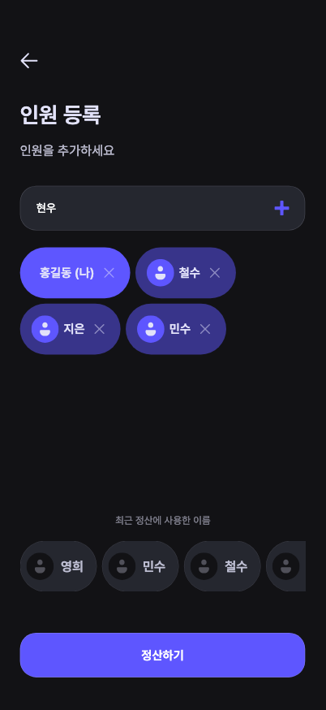 | 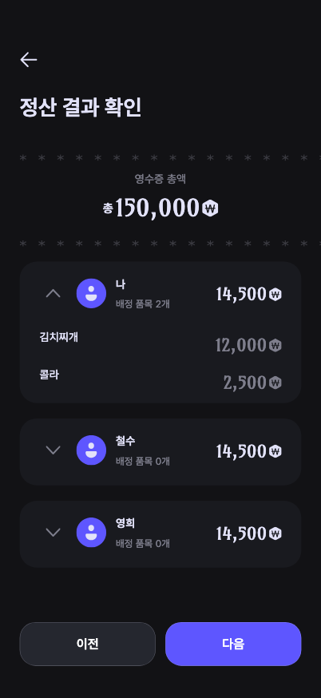 | 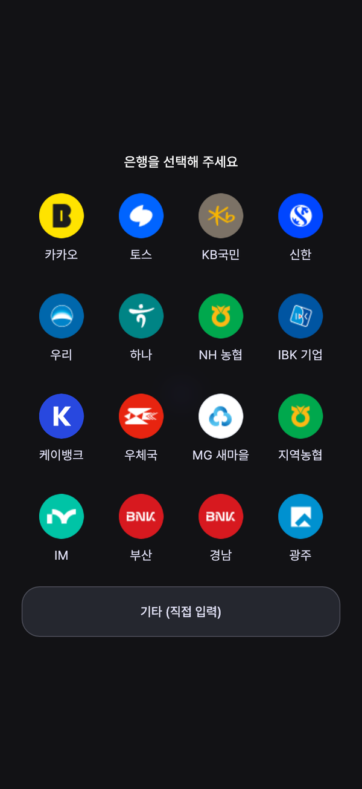 |

### 기록 관리

| 마이페이지 | 출석 현황과 무지출 기록 | 연속 기록 보상 |
| :---: | :---: | :---: |
| 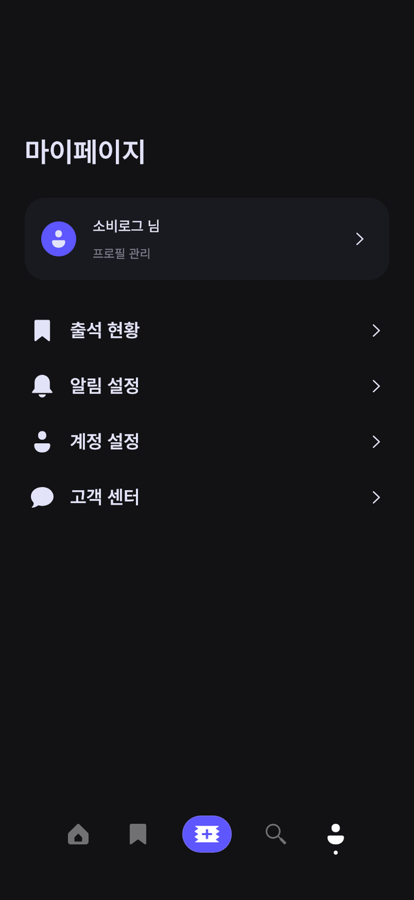 | 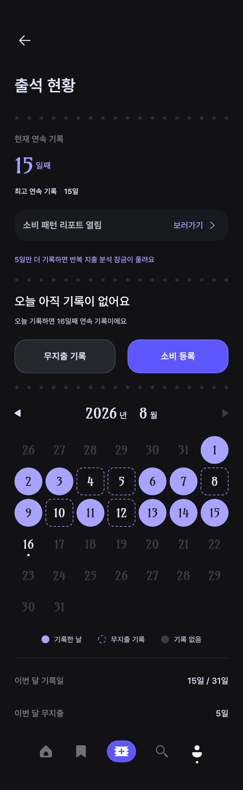 | 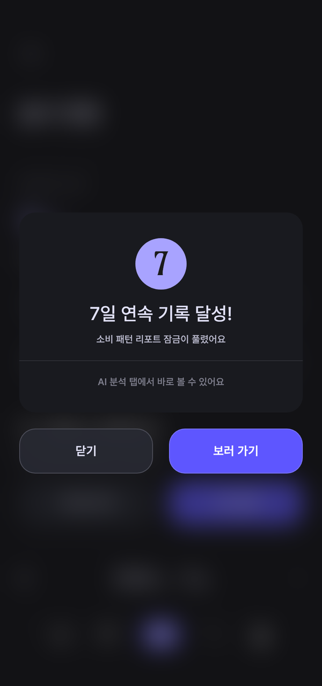 |

### 시작하기와 알림 설정

| 온보딩 | 로그인 | 알림 설정 |
| :---: | :---: | :---: |
| 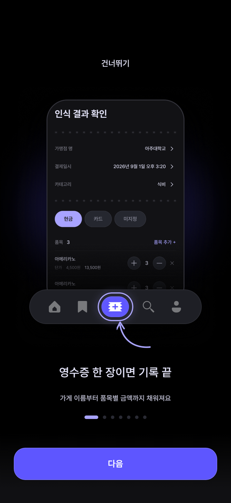 | 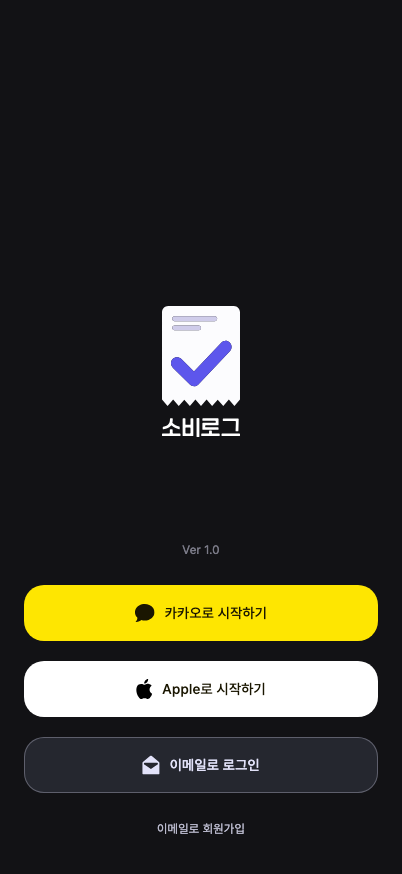 | 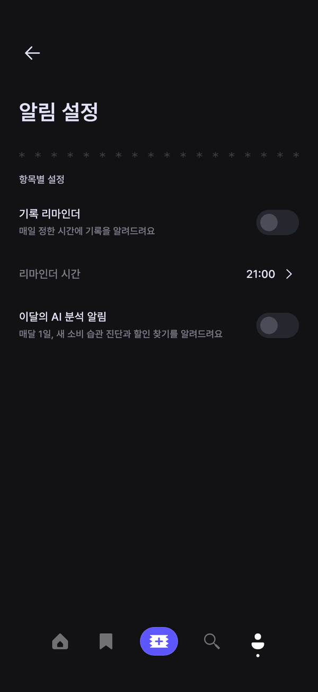 |

## 프로젝트 구성

| 저장소 | 역할 | 기술 |
| --- | --- | --- |
| [frontend](https://github.com/paran-accountbook/frontend) | iOS·Android 앱 UI, 영수증 촬영·첨부, 가계부 조회 및 정산 공유 | Flutter, Dart |
| [backend](https://github.com/paran-accountbook/backend) | 인증과 가계부 API, 영수증 OCR 및 품목 구조화, 소비 집계와 정산 계산 | Python, FastAPI, Supabase, CLOVA OCR, Google Gemini |

소스 저장소를 열려면 접근 권한이 필요합니다. 백엔드 인터페이스는 [API 문서](https://api.sobilog.kr/docs)에서 확인할 수 있습니다.

## 문의

[sobilog123@gmail.com](mailto:sobilog123@gmail.com)
